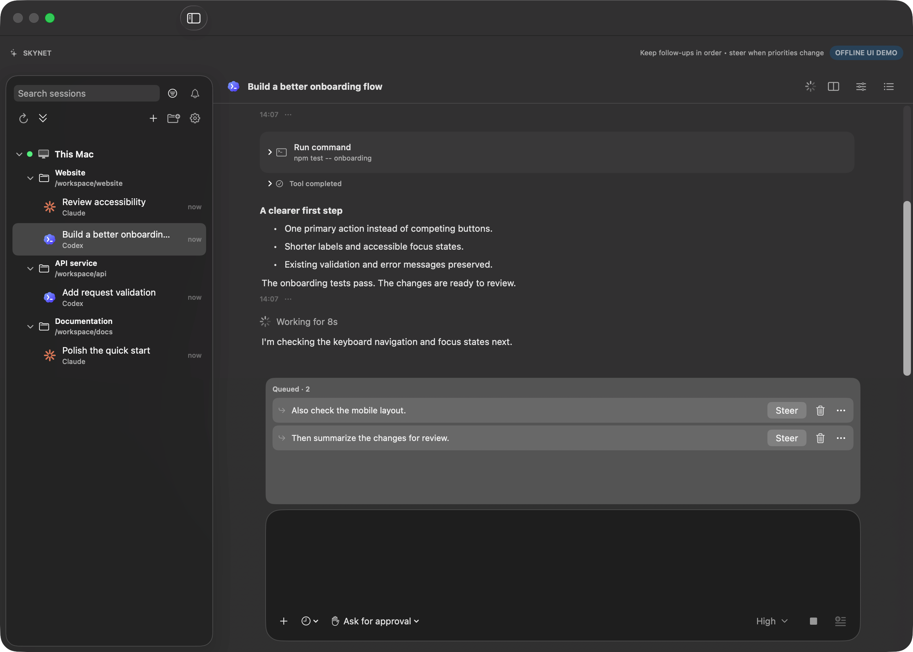

<p align="center">
  
</p>

<h1 align="center">Skynet</h1>

<p align="center">
  <strong>A native workspace for your coding agents.</strong><br>
  Codex &amp; Claude Code. Local &amp; SSH. One place to keep the work moving.
</p>

<p align="center">
  <a href="#demo">Demo</a> ·
  <a href="#what-you-can-do">Features</a> ·
  <a href="#quick-start">Quick start</a> ·
  <a href="docs/architecture.md">Architecture</a>
</p>

<p align="center"><code>macOS 14+</code> &nbsp; <code>SwiftUI</code> &nbsp; <code>Local + SSH</code></p>


Skynet brings CLI-backed coding sessions into a native macOS interface: switch projects,
read the conversation, line up follow-ups, and open the tools you need without losing context.
Your existing provider CLI does the agent work; Skynet handles the workspace around it.

## Demo


**Read → queue → continue.** Keep follow-ups visible while a turn is running.
Use **Steer** when priorities change, or reorder the waiting messages.

<details>
<summary>Take a closer look at the queue</summary>



</details>

> The demo uses production SwiftUI views with scripted sample data, not live provider execution.

## What you can do

| Keep context | Direct the work | Stay close to the code |
| --- | --- | --- |
| Group sessions by project and machine | Queue follow-ups, reorder them, or Steer | Open **Review**, **Files** and **Terminal** |
| Show cached sessions before refreshing | Review tool requests and stop the owning turn | Use the built-in **Browser** |
| Load older history without loading everything | See subagents and background activity | Ask a separate question with Codex **Side chat** |

- **Local and remote.** Run supported CLIs on this Mac or through SSH; connectivity hints
  update independently of history discovery, without clearing cached sessions.
- **A native composer.** Per-session drafts, undo/redo, skill and session references,
  image attachments, model controls and scheduled sending while the App is running.
- **Portable conversations.** Export stored history as JSON or Markdown.

Capabilities vary by provider. Side chat uses Codex's native side-conversation path;
Claude's auxiliary-chat entry uses the CLI. A visible action does not imply every remote
or custom-provider variant has been verified.

## Quick start

You need macOS 14+, full Xcode, and a supported provider CLI installed and authenticated
on the machine where it will run. Codex and Claude Code are built in; compatible executables
and default arguments can be configured in Skynet Settings.

### Build the macOS app

From the repository root:

```sh
# Point this at your full Xcode installation, not Command Line Tools.
export DEVELOPER_DIR="/Applications/Xcode.app/Contents/Developer"

xcodebuild -project Skynet.xcodeproj \
  -scheme SkynetMac -configuration Release \
  -destination 'platform=macOS' -derivedDataPath DerivedData

open DerivedData/Build/Products/Release/Skynet.app
```

If Xcode lives elsewhere, adjust `DEVELOPER_DIR`. `xcode-select` pointing to
Command Line Tools does **not** mean full Xcode is missing.

### Start working

1. Add a project folder, or select a discovered session in the sidebar.
2. Choose a provider and the appropriate model/permission mode.
3. Send a prompt. While it runs, add follow-ups to the queue.
4. Open the top-right side-panel menu for Review, Terminal, Browser, Files or Side chat.

For SSH sessions, install/authenticate the CLI on the remote machine and configure its
host alias in your SSH configuration. Skynet's SSH connectivity check is not a provider-service health check.

<details>
<summary>Development, tests and demo assets</summary>

Run the shared Core tests using the same Xcode toolchain:

```sh
swift test --package-path Packages/SkynetCore
```

The Xcode project is checked in. After changing targets or build settings, edit
`project.yml` and regenerate with XcodeGen:

```sh
xcodegen generate --spec project.yml
```

Regenerate the README images and GIF on macOS:

```sh
zsh Design/render-readme-demo.sh
```

The renderer uses production views with an isolated model. It does not open the installed
App, load its session store, discover remote hosts or send provider messages.

</details>

## Project map

| Target | Role |
| --- | --- |
| `SkynetMac` | Native macOS client with local/SSH CLI execution |
| `SkynetCore` | Shared provider, execution, transcript and persistence logic |
| `SkynetMobile` | Phone models, pairing credentials and encrypted relay protocol |
| `Skynet` | iOS/iPadOS client and relay contracts; never launches CLIs itself |

### iPhone and iPad

Build the `Skynet` scheme for an iPhone or iPad running iOS 18 or later.
On your Mac, open **Settings → Mobile Access**, enable access, and select the projects
you want to share. Scan the invitation in the iOS app and enter the six-digit code
shown on the Mac.

Keep both devices on the same network (or a private VPN), with Skynet open and the Mac
awake. The phone can browse recent conversations, send prompts and image attachments,
queue follow-ups, stop turns, and answer individual approval requests. Agent execution
and permission policy stay on the Mac. One Mac can be paired in the iOS app at a time.
Mobile access is off by default and can be revoked from Mac settings.

Read the [architecture boundaries](docs/architecture.md) for implementation details.

Before contributing, enable the staged-file privacy check with
`git config --local core.hooksPath .githooks`. CI also scans reachable Git history.

## References

- [HAPI](https://github.com/tiann/hapi) — a reference project for CLI-backed coding-agent workflows and mobile access.
- [Happy](https://github.com/slopus/happy) — a reference project for mobile access to Claude Code and Codex.
