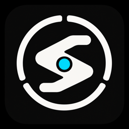
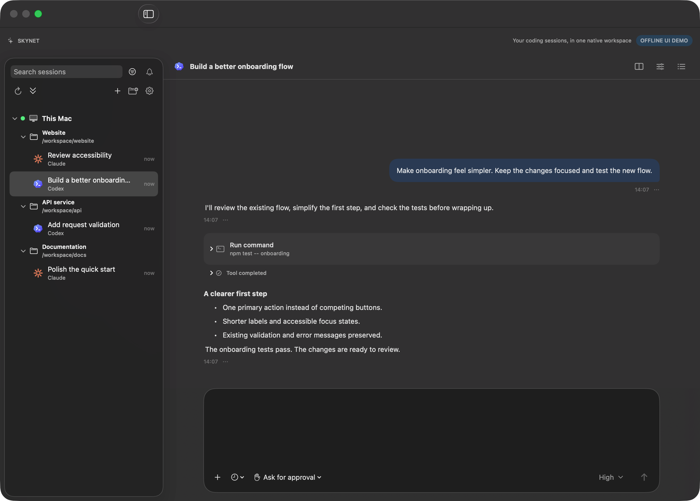
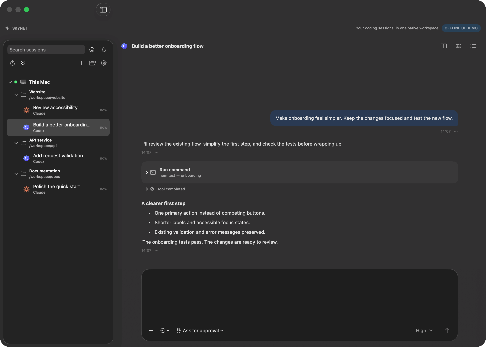
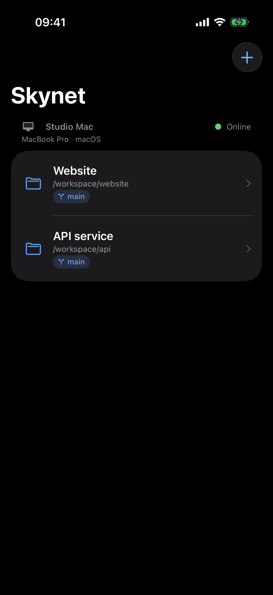

<p align="center">
  
</p>

<h1 align="center">Skynet</h1>

<p align="center">
  <strong>A native workspace for your coding agents.</strong><br>
  Codex &amp; Claude Code. On your Mac, with a paired iPhone or iPad.
</p>

<p align="center">
  <a href="#demo">Demo</a> ·
  <a href="#what-you-can-do">Features</a> ·
  <a href="#quick-start">Quick start</a> ·
  <a href="docs/architecture.md">Architecture</a>
</p>

<p align="center"><code>macOS 14+</code> &nbsp; <code>iOS 18+</code> &nbsp; <code>SwiftUI</code> &nbsp; <code>Local + SSH</code></p>



Skynet turns CLI-backed coding sessions into a native workspace. Browse projects,
read conversations, queue follow-ups and work with your code on Mac—or keep a turn moving
from your phone. Your provider CLI runs on the Mac or an SSH host; Skynet handles the interface.

## Demo

### Mac



**Read → queue → continue.** Keep follow-ups visible while a turn is running.
Use **Steer** when priorities change, or reorder the waiting messages.

### iPhone and iPad

<p align="center">
  
</p>

**Pair → browse → follow up.** Read recent conversations, send text or images,
manage waiting prompts, stop a turn and answer approval requests.

> Demos use production SwiftUI views with sample data, not live provider execution.

## What you can do

On Mac:

| Keep context | Direct the work | Stay close to the code |
| --- | --- | --- |
| Group sessions by project and machine | Queue follow-ups, reorder them, or Steer | Open **Review**, **Files** and **Terminal** |
| Show cached sessions before refreshing | Review tool requests and stop the owning turn | Use the built-in **Browser** |
| Load older history without loading everything | See subagents and background activity | Ask a separate question with Codex **Side chat** |

The native composer supports per-session drafts, undo/redo, image attachments, skill
references and model controls. Schedule messages while the App is open, or export
conversations as JSON or Markdown.

Capabilities vary by provider. Codex Side chat uses its native side-conversation path;
Claude auxiliary chat uses the CLI.

## Quick start

Use macOS 14+ and an installed, authenticated Codex or Claude Code CLI.
Building from source requires full Xcode; custom CLI paths belong in **Settings**.

### Build the macOS app

```sh
# Point this at your full Xcode installation, not Command Line Tools.
export DEVELOPER_DIR="/Applications/Xcode.app/Contents/Developer"

xcodebuild -project Skynet.xcodeproj \
  -scheme SkynetMac -configuration Release \
  -destination 'platform=macOS' -derivedDataPath DerivedData

open DerivedData/Build/Products/Release/Skynet.app
```

### Start working

Add a project or open a discovered session, choose a provider, then send a prompt.
Queue follow-ups while it runs; open code tools from the top-right side-panel button.

For SSH sessions, configure a host alias and install/authenticate the provider CLI on that host.

### Connect your phone

The iOS client is available from source; build the **Skynet** scheme for iOS 18+.

1. On Mac, open **Settings → Mobile Access**, enable access and select projects to share.
2. In the iOS app, scan the invitation and enter the six-digit code shown on Mac.
3. Keep Skynet open and the Mac awake, with both devices on the same network or a private VPN.

The phone pairs with one Mac at a time; execution and permission policy stay on the Mac.
Mobile access is off by default. Share selected projects and revoke devices from Mac settings.

<details>
<summary>Development</summary>

From the repository root, with `DEVELOPER_DIR` set to your full Xcode installation:

```sh
swift test --package-path Packages/SkynetCore
xcodegen generate --spec project.yml  # after changing targets or build settings
zsh Design/render-readme-demo.sh
# Choose an available iPhone simulator from `xcrun simctl list devices`.
zsh Design/render-ios-demo.sh <simulator-UDID>
git config --local core.hooksPath .githooks
```

</details>

## Project map

| Target | Role |
| --- | --- |
| `SkynetMac` | Native macOS client with local/SSH CLI execution |
| `SkynetCore` | Shared provider, execution, transcript and persistence logic |
| `SkynetMobile` | Phone models, pairing credentials and encrypted relay protocol |
| `Skynet` | iOS/iPadOS client; delegates execution to a paired Mac |

See [Architecture](docs/architecture.md) for module boundaries and execution ownership.

## References

- [HAPI](https://github.com/tiann/hapi) — a reference project for CLI-backed coding-agent workflows and mobile access.
- [Happy](https://github.com/slopus/happy) — a reference project for mobile access to Claude Code and Codex.
